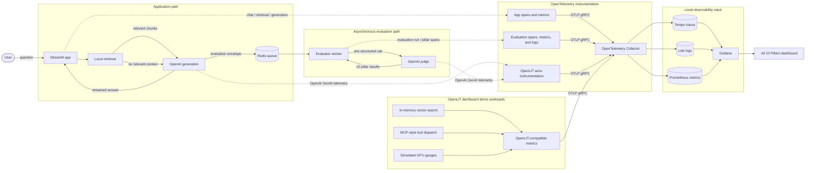

# Open-source Grafana AI evaluation framework

A locally deployable GenAI observability and evaluation stack built with Streamlit, OpenAI, OpenTelemetry, Redis, Grafana, Tempo, Loki, and Prometheus.

The Streamlit application answers both RAG and general-knowledge questions. Each completed answer is evaluated asynchronously across ten quality and safety pillars in one structured LLM-as-a-judge call. Traces, metrics, and structured logs are exported to the local LGTM-style stack and shown in a provisioned Grafana dashboard.

## What you get

- Streaming OpenAI chat application in Streamlit
- Lightweight retrieval over a local demo corpus
- General-knowledge fallback when no relevant local context exists
- Asynchronous Redis-backed evaluation worker
- Ten quality and safety evaluation pillars
- OpenTelemetry traces, metrics, and logs
- OpenLIT automatic OpenAI instrumentation for standard GenAI metrics
- Local Tempo, Loki, Prometheus, and Grafana services
- Provisioned Grafana datasources, the custom 13-panel dashboard, and five official Grafana OpenLIT dashboards
- Compose-managed VectorDB, MCP, and optional simulated-GPU demo telemetry
- Privacy-safe telemetry defaults
- Pinned application and container versions

## Architecture



### Request and telemetry flow

1. Streamlit receives a question and creates a `chat.request` root span.
2. `rag.retrieve` selects relevant local documents. Zero-relevance documents are discarded.
3. `gen_ai.chat` streams the OpenAI answer. Relevant local context is cited; otherwise the model answers from general knowledge.
4. The app pushes an immutable evaluation envelope to Redis without delaying the user response.
5. The worker makes one structured judge call and validates all ten results with Pydantic.
6. `eval.run` is linked to the original request using an OpenTelemetry span link. Each result also receives an `eval.pillar.<name>` child span.
7. The collector routes traces to Tempo, logs to Loki, and metrics to its Prometheus endpoint.
8. Prometheus scrapes evaluation metrics and Grafana queries all three backends.

## Evaluation pillars

Higher scores are always better. Scores range from `0.0` to `1.0`.

| Pillar | What it measures | Pass threshold |
|---|---|---:|
| Groundedness | Whether claims are supported by retrieved local context | 0.80 |
| Hallucination avoidance | Absence of fabricated, contradictory, or unsupported claims | 0.80 |
| Correctness | Factual and logical accuracy | 0.80 |
| Answer relevance | Directness and alignment with the question | 0.75 |
| Completeness | Coverage of important information at an appropriate depth | 0.75 |
| Helpfulness/value | Useful and actionable value for the user's goal | 0.75 |
| Clarity/coherence | Readability, concision, organization, and consistency | 0.75 |
| Instruction adherence | Compliance with the request and citation rules | 0.80 |
| Safety/toxicity | Safe, non-abusive output that does not facilitate meaningful harm | 0.95 |
| Bias/fairness | Absence of unjustified stereotypes or discriminatory treatment | 0.95 |

Groundedness is `not_applicable` when the retriever supplies no relevant local context. This is different from failure: a general-knowledge answer can be correct and non-hallucinatory without being grounded in the local corpus.

## Prerequisites

- Docker Engine with Docker Compose v2
- An OpenAI API key
- Approximately 4 GB of free memory for the complete local stack
- Ports `3000`, `3100`, `3200`, `4317`, `4318`, `8501`, and `9090` available

No local Python installation is required for normal deployment.

## Quick start

1. Create your local environment file:

   ```bash
   cp .env.example .env
   ```

2. Open `.env` and set the API key:

   ```dotenv
   OPENAI_API_KEY=your-key-here
   ```

3. Start the complete stack:

   ```bash
   docker compose up --build -d
   ```

4. Confirm service health:

   ```bash
   docker compose ps
   ```

5. Open the application and dashboard:

   - Streamlit: <http://localhost:8501>
   - Grafana: <http://localhost:3000>
   - All-pillars dashboard: <http://localhost:3000/d/genai-eval-slice>
   - Prometheus: <http://localhost:9090>

Grafana credentials come from `GRAFANA_ADMIN_USER` and `GRAFANA_ADMIN_PASSWORD` in `.env`.

Try these questions:

- `What does LGTM mean?` exercises local retrieval and groundedness.
- `What is the capital of India?` exercises general-knowledge fallback and marks groundedness not applicable.
- `Why should prompt capture be disabled by default?` exercises the privacy document in the local corpus.

Allow several seconds after the answer appears for the asynchronous judge and metric export to complete.

## Startup and shutdown scripts

The recommended deployment interface is provided by two scripts. They resolve the repository directory automatically, so they can be invoked from any working directory.

### Start

```bash
./scripts/start.sh
```

The startup script:

- Checks that Docker and Docker Compose v2 are available
- Creates `.env` from `.env.example` when it is missing, then stops so the key can be added
- Checks that `OPENAI_API_KEY` is non-empty without printing it
- Validates the rendered Compose configuration
- Builds and starts every service in detached mode
- Prints container status and the application URLs

Optional service names or supported `docker compose up` arguments can be passed through. For example, to start only the observability services:

```bash
./scripts/start.sh loki tempo otel-collector prometheus grafana
```

For the complete framework, run the script without arguments.

### Stop

```bash
./scripts/stop.sh
```

This runs `docker compose down`, removing project containers and the network while preserving persistent Grafana, Tempo, Loki, Prometheus, and Redis volumes.

To deliberately delete all persistent local data as well:

```bash
./scripts/stop.sh --volumes
```

The `--volumes` operation is destructive and cannot recover the deleted local telemetry or queue data.

## Configuration

All credentials, endpoints, models, and runtime controls live in the gitignored `.env` file.

| Variable | Purpose | Example/default |
|---|---|---|
| `OPENAI_API_KEY` | OpenAI credential used by generation and judging | Required |
| `OPENAI_BASE_URL` | OpenAI-compatible API endpoint | `https://api.openai.com/v1` |
| `GENERATION_MODEL` | Model that answers Streamlit questions | `gpt-4.1-mini` |
| `JUDGE_MODEL` | Model that evaluates answers | `gpt-4.1-mini` |
| `OTEL_EXPORTER_OTLP_ENDPOINT` | OTLP gRPC collector endpoint | `http://otel-collector:4317` |
| `OTEL_SERVICE_NAME` | Generation service resource name | `streamlit-genai-app` |
| `REDIS_URL` | Evaluation queue connection | `redis://redis:6379/0` |
| `EVAL_SAMPLE_RATE` | Fraction of successful answers evaluated | `1.0` |
| `EVAL_RUBRIC_VERSION` | Version attached to evaluation telemetry | `v1` |
| `CAPTURE_CONTENT` | Include judge reasons/evidence in telemetry | `false` |
| `OPENLIT_ENABLED` | Enable OpenLIT auto-instrumentation alongside custom telemetry | `true` |
| `DEMO_GPU_SIMULATION` | Emit clearly labeled GPU demo gauges when real NVIDIA telemetry is unavailable | `true` |
| `DEMO_WORKLOAD_INTERVAL_SECONDS` | Interval between VectorDB, MCP, and GPU demo samples | `1` |
| `GRAFANA_ADMIN_USER` | Initial Grafana administrator | `admin` |
| `GRAFANA_ADMIN_PASSWORD` | Initial Grafana password | Set a local value |

### Change models

Edit the two model variables in `.env`:

```dotenv
GENERATION_MODEL=gpt-4.1-mini
JUDGE_MODEL=gpt-4.1-mini
```

The models may be different. Use model IDs available to your OpenAI account or configured base URL. Recreate the application containers after a change:

```bash
docker compose up -d --force-recreate streamlit-app evaluator-worker
```

### Enable detailed evaluation explanations

The safe default is:

```dotenv
CAPTURE_CONTENT=false
```

Set it to `true` only for non-sensitive test data if judge reasons and evidence should be attached to spans and Loki logs. The question, answer, and retrieved context must still be sent to the judge API for evaluation, regardless of the telemetry setting.

## Services and ports

| Service | Role | Host port |
|---|---|---:|
| `streamlit-app` | Chat UI, retrieval, generation, and job submission | 8501 |
| `evaluator-worker` | Structured ten-pillar LLM-as-a-judge evaluation | None |
| `redis` | Asynchronous evaluation queue | Internal only |
| `otel-collector` | OTLP ingestion and signal routing | 4317, 4318 |
| `tempo` | Trace storage and TraceQL | 3200 |
| `loki` | Structured log storage and LogQL | 3100 |
| `prometheus` | Metrics storage and PromQL | 9090 |
| `grafana` | Dashboards and cross-signal exploration | 3000 |
| `dashboard-loader` | One-shot provisioning of five pinned upstream OpenLIT dashboards | None |
| `openlit-demo-workloads` | Generates VectorDB/MCP activity and optional simulated GPU telemetry | None |

## Instrumentation model

### Traces

Generation trace:

```text
chat.request
├── rag.retrieve
└── gen_ai.chat
```

Asynchronous evaluation trace:

```text
eval.run  -- OpenTelemetry link -->  chat.request
├── eval.pillar.groundedness
├── eval.pillar.hallucination_avoidance
├── eval.pillar.correctness
├── eval.pillar.answer_relevance
├── eval.pillar.completeness
├── eval.pillar.helpfulness_value
├── eval.pillar.clarity_coherence
├── eval.pillar.instruction_adherence
├── eval.pillar.safety_toxicity
└── eval.pillar.bias_fairness
```

Important correlation attributes include `app.request.id`, `app.origin.trace_id`, `eval.pillar`, `eval.score`, `eval.pass`, `eval.applicable`, and `eval.rubric.version`.

### Metrics

The dashboard uses these low-cardinality metrics:

- `genai_requests_total`
- `genai_request_duration_seconds`
- `genai_eval_runs_total`
- `genai_eval_score`
- `genai_eval_duration_seconds`

Request IDs, prompts, responses, judge reasons, and document contents are deliberately excluded from metric labels.

### Logs

Python logs are exported through OTLP to Loki. Evaluation result logs contain the request ID and per-pillar scores/verdicts. Reasons and evidence are present only when `CAPTURE_CONTENT=true`.

In Grafana Explore, select Loki and query:

```logql
{service_name="genai-evaluator-worker"}
```

### Dashboard

The provisioned `GenAI Evaluation — All 10 Pillars` dashboard has no pillar dropdowns. It shows every pillar simultaneously through:

- Overall evaluation, quality, failure, error, and traffic statistics
- Average score by pillar
- Pass rate by pillar
- Score trends for all pillars
- Pass/fail/not-applicable distribution
- Generation and judge latency
- Evaluation coverage by pillar

The summary panels use a fixed six-hour PromQL window, while trend panels follow the displayed timeline.

### OpenLIT instrumentation and dashboards

OpenLIT 1.45.0 is initialized by `openlit_setup.py` in both the Streamlit process and evaluator worker, after the shared OpenTelemetry providers are configured. OpenLIT reuses those providers and automatically instruments OpenAI generation and judge calls. The existing application, RAG, correlation, and ten-pillar instrumentation remains in place.

The shared resource is labeled `telemetry.sdk.name=openlit`, which is required by the PromQL selectors in Grafana's official dashboards. OpenLIT emits standard GenAI latency, token, model, provider, and estimated-cost metrics, plus OpenAI spans. Generic HTTP instrumentors and OpenLIT event logs are disabled because instrumenting the OTLP exporters themselves can cause recursive or rejected exports; custom privacy-safe evaluation logs supply the dashboard evaluation signal instead.

Signal routing is:

```text
OpenAI calls -- OpenLIT spans/metrics --┐
Ten-pillar evaluations -- JSON logs ---+--> OpenTelemetry Collector
Demo workloads -- schema metrics ------┘             │
                                                      ├── Tempo: traces
                                                      ├── Loki: evaluation logs
                                                      └── Prometheus: metrics
```

#### How every OpenLIT dashboard gets data

| Dashboard | URL | Data producer | Backend and principal signals |
|---|---|---|---|
| GenAI Observability | <http://localhost:3000/d/cdiz9piuoa3ggc> | Streamlit generation and evaluator OpenAI calls | Prometheus: `gen_ai_client_operation_duration_seconds`, `gen_ai_client_token_usage`, `gen_ai_usage_cost_USD`; Tempo: OpenAI spans |
| GenAI Evaluations | <http://localhost:3000/d/is7rtn6> | Evaluator worker, one record for every applicable or not-applicable pillar | Loki JSON fields: `gen_ai.evaluation.name`, `gen_ai.evaluation.score.label`, and `gen_ai.evaluation.score.value` |
| VectorDB Observability | <http://localhost:3000/d/is5nc7p> | `openlit-demo-workloads`, using real in-memory vector query/upsert operations | Prometheus: `db_requests_total` and `db_client_operation_duration_seconds` with operation/system labels |
| MCP Observability | <http://localhost:3000/d/isldpl4> | `openlit-demo-workloads`, using MCP-style `add`, `echo`, and `document_lookup` dispatches | Prometheus: requests, tool calls, controlled errors, latency, request size, and response size |
| GPU Monitoring | <http://localhost:3000/d/adu2uyzl5ih34e> | `openlit-demo-workloads` | Prometheus: power, fan, memory, temperature, utilization, encode, and decode gauges |

The VectorDB and MCP workload operations are executed continuously rather than being static samples. GPU values are simulated because Docker hosts do not necessarily expose an NVIDIA device; every GPU series carries `gpu.mode=simulated` and `gpu.name="OpenLIT Demo GPU"`. Set `DEMO_GPU_SIMULATION=false` before connecting a real GPU exporter so simulated and physical-device data are not mixed.

The generator runs every second by default. Change its cadence in `.env`:

```dotenv
DEMO_WORKLOAD_INTERVAL_SECONDS=1
DEMO_GPU_SIMULATION=true
```

After changing these values, recreate only the generator:

```bash
docker compose up -d --force-recreate openlit-demo-workloads
```

#### Evaluation log compatibility

The judge produces one structured result containing all ten pillars. The worker retains the custom evaluation metrics and additionally emits one privacy-safe OpenLIT-compatible JSON log for each pillar. A typical record is:

```json
{"event.name":"gen_ai.evaluation","gen_ai.evaluation.name":"correctness","gen_ai.evaluation.score.label":"pass","gen_ai.evaluation.score.value":0.95,"app.request.id":"..."}
```

Reasons and evidence are added only when `CAPTURE_CONTENT=true`. Under the default `false`, dashboard records contain scores, verdicts, pillar names, and correlation IDs but no prompt, answer, reason, or evidence text.

#### Dashboard provisioning and no-filter behavior

At startup, `dashboard-loader` copies the custom dashboard and downloads five official dashboards from a pinned commit of Grafana's open-source `grafana-aio11y-app` repository. Files are persisted in the `dashboards-data` volume, so normal restarts reuse them.

`patch_openlit_dashboards.py` then normalizes the upstream JSON for this local deployment:

- Hard-codes the provisioned Prometheus, Loki, and Tempo datasource UIDs.
- Removes service, environment, and datasource dropdown dependencies.
- Uses Loki-safe universal selectors (`=~".+"` rather than the invalid all-empty `=~".*"`).
- Sets a rolling 30-minute time range and 10-second refresh.

Consequently, no dashboard filtering is required. If a dashboard was already open while it was re-provisioned, perform one browser hard refresh or reopen its base URL.

#### OpenLIT controls

Set `OPENLIT_ENABLED=false` to disable OpenLIT OpenAI auto-instrumentation while preserving custom application/evaluation telemetry and the demo workload. OpenLIT content capture follows `CAPTURE_CONTENT`; prompt and completion content is excluded from telemetry by default.

To confirm the data-producing service is running:

```bash
docker compose ps openlit-demo-workloads
docker compose logs --tail=20 openlit-demo-workloads
```

## Repository layout

```text
.
├── compose.yaml
├── .env.example
├── Makefile
├── PLAN.md
├── README.md
├── scripts/
│   ├── start.sh
│   └── stop.sh
├── app/
│   ├── Dockerfile
│   ├── requirements.txt
│   ├── data/documents.json
│   └── src/
│       ├── config.py
│       ├── demo_workloads.py
│       ├── generation.py
│       ├── openlit_setup.py
│       ├── rag.py
│       ├── telemetry.py
│       ├── ui.py
│       └── worker.py
└── observability/
    ├── collector/config.yaml
    ├── grafana/
    │   ├── dashboards/genai-evaluations.json
    │   ├── patch_openlit_dashboards.py
    │   └── provisioning/
    ├── loki/loki.yaml
    ├── prometheus/prometheus.yaml
    └── tempo/tempo.yaml
```

## Operations

Start or update the stack:

```bash
docker compose up --build -d
```

Watch the application and telemetry pipeline:

```bash
docker compose logs -f streamlit-app evaluator-worker otel-collector
```

Inspect evaluation results:

```bash
docker compose logs --tail=100 evaluator-worker
```

Stop containers while retaining local data:

```bash
docker compose down
```

Delete containers and all local telemetry/queue volumes:

```bash
docker compose down -v
```

The final command permanently removes the local Grafana, Tempo, Loki, Prometheus, and Redis data volumes.

## Verification

Check that every service is running:

```bash
docker compose ps
```

Check Streamlit health:

```bash
curl -fsS http://localhost:8501/_stcore/health
```

Check Grafana health:

```bash
curl -fsS http://localhost:3000/api/health
```

Check that evaluation metrics exist:

```bash
curl -fsS -G http://localhost:9090/api/v1/query \
  --data-urlencode 'query=count by (eval_pillar) (genai_eval_runs_total)'
```

Check Loki labels:

```bash
curl -fsS http://localhost:3100/loki/api/v1/labels
```

## Troubleshooting

### The app says the context does not contain the answer

Rebuild and recreate the application containers to ensure the current general-knowledge fallback code is running:

```bash
docker compose build streamlit-app evaluator-worker
docker compose up -d --force-recreate streamlit-app evaluator-worker
```

### The selected model is unavailable or at capacity

Set `GENERATION_MODEL` and `JUDGE_MODEL` in `.env` to models available to your account, then recreate both application containers. Generation and judging can use different models.

### The dashboard contains no data

1. Submit at least one Streamlit question.
2. Wait several seconds for asynchronous evaluation and metric export.
3. Confirm `evaluator-worker` shows `evaluation_result`.
4. Confirm Prometheus reports the `genai_eval_runs_total` metric.
5. Hard-refresh the dashboard if Grafana had been open during provisioning.

### Grafana reports an unexpected dashboard error

The checked-in dashboard targets Grafana 12.1 and uses its supported color modes and panel schemas. Validate and reload it with:

```bash
python3 -m json.tool observability/grafana/dashboards/genai-evaluations.json >/dev/null
docker compose restart grafana
```

Then hard-refresh <http://localhost:3000/d/genai-eval-slice>.

### Evaluation fails while the answer succeeds

This is expected isolation: evaluation is asynchronous and never blocks the user response. Inspect:

```bash
docker compose logs --tail=100 evaluator-worker otel-collector
```

Typical causes are judge-model availability, API rate limits, malformed structured output, or an invalid API key.

### Grafana login no longer accepts `.env` credentials

Grafana applies administrator credentials only when initializing a new data volume. Changing `.env` later does not replace the password stored in an existing Grafana database. Preserve the existing password or deliberately recreate the Grafana volume if losing local dashboard state is acceptable.

## Privacy, cost, and limitations

- Never commit `.env`; it is already ignored by Git.
- Content capture is disabled by default.
- The judge still receives the question, response, and relevant context through the configured OpenAI endpoint.
- Every sampled answer uses one generation call and one judge call. Reduce `EVAL_SAMPLE_RATE` to control judge cost.
- LLM-as-a-judge scores are estimates, not ground truth. Calibrate rubrics against human-labelled examples before production use.
- The bundled corpus and lexical retriever are intentionally small. Replace them with a production retrieval system for real RAG workloads.
- Redis list consumption in this reference implementation does not yet provide production-grade acknowledgements or a dead-letter queue.
- This setup is designed for local development, demonstrations, and evaluation prototyping—not internet-facing production deployment.

## Further work

See [PLAN.md](PLAN.md) for the broader roadmap, including golden datasets, judge calibration, durable retry/dead-letter behavior, alerting, cost tracking, and production hardening.
